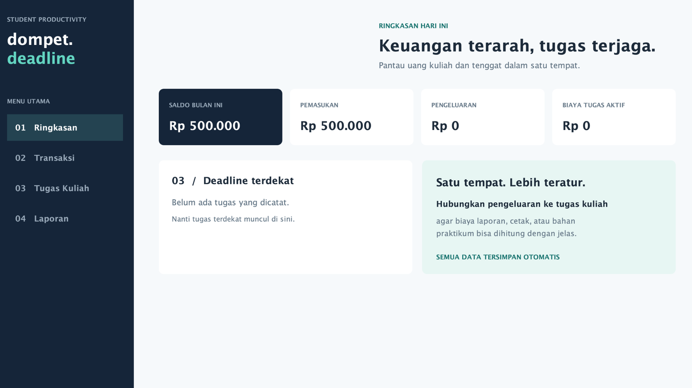
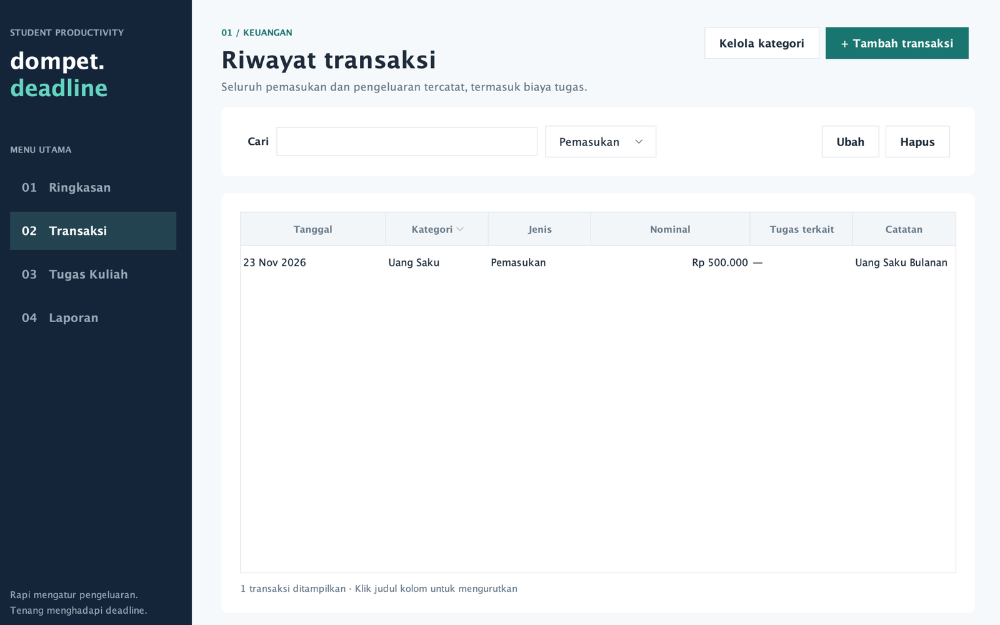
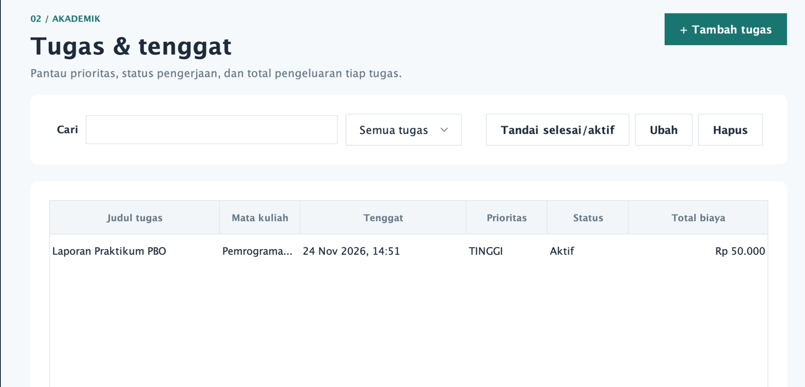
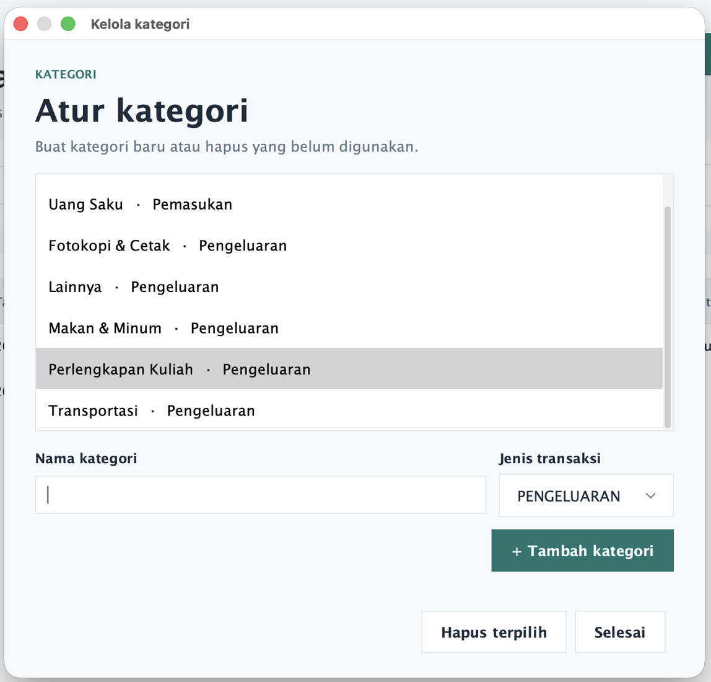

# Dompet Deadline

**Uang lebih terkendali, tugas kuliah lebih terpantau.**

Dompet Deadline adalah aplikasi desktop berbasis Java untuk membantu mahasiswa mencatat pemasukan dan pengeluaran, mengelola tugas kuliah, serta melihat biaya yang dikeluarkan untuk setiap tugas. Pengguna dapat menghubungkan transaksi pengeluaran dengan tugas, misalnya biaya mencetak laporan praktikum.

Proyek ini dikembangkan untuk **Tugas Besar Praktikum Pemrograman Berorientasi Objek** menggunakan **Java Swing, JDBC, dan SQLite**.

## Tampilan Aplikasi

Screenshot berikut berasal dari aplikasi yang dijalankan pada macOS dengan data contoh.

### Dashboard



### Riwayat Transaksi



### Tugas Kuliah



### Kelola Kategori



## Fitur Utama

| Fitur | Keterangan |
| --- | --- |
| Dashboard | Menampilkan saldo bulan berjalan, pemasukan, pengeluaran, biaya tugas aktif, dan tiga deadline terdekat. |
| Transaksi | Tambah, ubah, hapus, urutkan, cari, dan filter transaksi pemasukan/pengeluaran. |
| Kategori | Kelola kategori pemasukan dan pengeluaran sesuai kebutuhan pengguna. |
| Tugas Kuliah | Tambah, ubah, hapus, tandai selesai/aktif; catat mata kuliah, tenggat, prioritas, dan total biaya tiap tugas. |
| Kaitan Transaksi–Tugas | Hubungkan pengeluaran, seperti biaya fotokopi atau bahan praktikum, dengan tugas tertentu. |
| Grafik Pengeluaran | Grafik batang horizontal per kategori untuk bulan terpilih, digambar langsung dengan `paintComponent`. |
| Pengingat Deadline | Pemeriksaan berkala untuk tugas aktif yang jatuh tempo dalam 24 jam; notifikasi melalui System Tray dengan dialog sebagai cadangan. |
| Ekspor CSV | Ekspor transaksi melalui dialog pemilihan lokasi, berformat UTF-8 untuk dibuka di aplikasi spreadsheet. |
| Penyimpanan Lokal | Data disimpan secara permanen menggunakan SQLite melalui JDBC, di folder pengguna. |

**Fitur tambahan:** antarmuka FlatLaf, pencarian/filter transaksi dan tugas, serta build menggunakan Maven.

## Teknologi

- **Java 17+** dan **Swing** — antarmuka aplikasi desktop.
- **SQLite** dan **JDBC** — penyimpanan data permanen.
- **Maven** — pengelolaan dependensi, build, dan pengujian.
- **FlatLaf** — tampilan antarmuka modern.
- **JUnit 5** — pengujian logika aplikasi.
- **Maven Shade Plugin** — menghasilkan JAR yang dapat dijalankan.

## Persyaratan

- JDK 17 atau versi lebih baru.
- Maven 3.9 atau versi yang kompatibel.
- Git untuk meng-clone proyek (opsional jika menggunakan unduhan ZIP).

## Cara Instalasi dan Menjalankan

1. Clone repository:

   ```bash
   git clone https://github.com/Hyouka-jpg/dompet-deadline.git
   cd dompet-deadline
   ```

2. Jalankan pengujian dan build:

   ```bash
   mvn clean test
   mvn clean package
   ```

3. Jalankan aplikasi:

   ```bash
   java -jar target/dompet-deadline-1.0.0.jar
   ```

Pada Java versi baru, apabila muncul peringatan akses native dari SQLite JDBC, aplikasi dapat dijalankan dengan:

```bash
java --enable-native-access=ALL-UNNAMED -jar target/dompet-deadline-1.0.0.jar
```

**Pengguna macOS:** Maven dapat dipasang menggunakan Homebrew dengan `brew install maven` apabila belum tersedia.

## Cara Menggunakan

1. Buka **Tugas Kuliah**, kemudian tambahkan judul, mata kuliah, prioritas, dan tanggal/jam tenggat.
2. Buka **Transaksi** dan catat pemasukan, misalnya uang saku bulanan.
3. Untuk biaya tugas, tambahkan transaksi **Pengeluaran**, pilih kategori dan **Tugas terkait**.
4. Periksa **Ringkasan** untuk melihat saldo, biaya tugas aktif, dan deadline terdekat.
5. Buka **Laporan** untuk melihat grafik berdasarkan bulan atau mengekspor data transaksi ke CSV.

**Format input:** tanggal transaksi `HH/BB/TTTT`, tenggat `HH/BB/TTTT JJ:MM`, dan nominal sebagai rupiah bulat (misalnya `25000`).

## Penyimpanan Data

Database dibuat secara otomatis di folder pengguna:

- **macOS/Linux:** `~/.dompet-deadline/dompet-deadline.db`
- **Windows:** `%USERPROFILE%\.dompet-deadline\dompet-deadline.db`

**Penting:** file database pribadi tidak boleh diunggah ke GitHub. Konfigurasi `.gitignore` disiapkan untuk mengecualikan file database dan hasil build.

## Struktur Proyek

```text
dompet-deadline/
├── pom.xml
├── README.md
├── LICENSE
├── .gitignore
├── docs/
│   └── screenshots/
│       ├── dashboard.png
│       ├── transaksi.png
│       ├── tugas.png
│       └── kategori.png
└── src/
    ├── main/java/id/ac/usk/dompetdeadline/
    │   ├── Main.java
    │   ├── model/        # Kelas data kategori, transaksi, tugas, dashboard
    │   ├── repository/   # Akses SQLite/JDBC dan query SQL
    │   ├── service/      # Logika perhitungan, validasi, ekspor CSV
    │   └── view/         # Swing frame, panel, dialog, grafik, notifikasi
    └── test/java/id/ac/usk/dompetdeadline/service/
        └── ...           # Unit test JUnit 5
```

Dokumentasi pendukung tersedia secara lokal sebagai `CHECKLIST_PENGUJIAN.md` dan `PANDUAN_COMMIT.md` jika diperlukan.

## Rancangan Database

Tabel utama:

- `kategori` — `id`, `nama`, `jenis`.
- `tugas` — `id`, `judul`, `mata_kuliah`, `tenggat`, `prioritas`, `selesai`.
- `transaksi` — `id`, `tanggal`, `jumlah`, `kategori_id`, `tugas_id` (opsional), `catatan`.
- `pengingat` — menyimpan catatan notifikasi tenggat agar pengingat tidak berulang untuk tugas/tenggat yang sama.

Tabel transaksi memiliki hubungan ke kategori dan dapat dihubungkan ke tugas. Pemisahan kode menggunakan paket `model`, `repository`, `service`, dan `view`. Nilai rupiah direpresentasikan sebagai bilangan bulat (`long` di Java); SQL menggunakan `PreparedStatement` untuk parameter dari pengguna. Antarmuka memakai layout manager, bukan `setLayout(null)`.

## Pengujian

Pengujian dijalankan dengan:

```bash
mvn clean test
```

Hasil pengujian terakhir pada **26 November 2026**:

| Kelas Test | Jumlah | Hasil |
| --- | ---: | --- |
| `DeadlineRulesTest` | 2 | Lulus |
| `DateFormatsTest` | 3 | Lulus |
| `FinanceMathTest` | 3 | Lulus |
| `CsvExporterTest` | 3 | Lulus |
| **Total** | **11** | **11 lulus, 0 gagal, 0 error** |

Selain unit test, pencatatan pemasukan dan keterkaitan pengeluaran dengan biaya tugas sudah dicoba langsung melalui antarmuka. Pengujian manual lanjutan masih diperlukan untuk memastikan grafik, ekspor CSV melalui dialog, dan notifikasi deadline di berbagai sistem operasi bekerja sesuai harapan.

## Build JAR dan GitHub Releases

```bash
mvn clean package
```

File hasil build tersedia di:

```text
target/dompet-deadline-1.0.0.jar
```

File JAR ini dapat diunggah melalui halaman [GitHub Releases](https://github.com/Hyouka-jpg/dompet-deadline/releases) dengan tag, misalnya `v1.0.0`, setelah pengujian akhir selesai. **JAR tidak disimpan di repository sumber**, karena folder `target/` dikecualikan melalui `.gitignore`.

## Lisensi

Proyek ini menggunakan lisensi MIT. Lihat [LICENSE](LICENSE).
